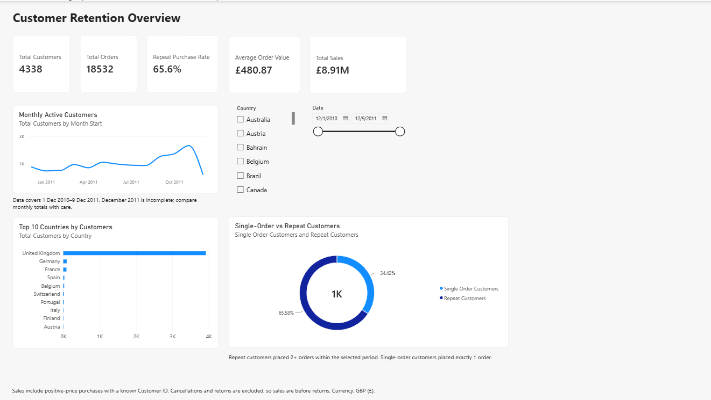
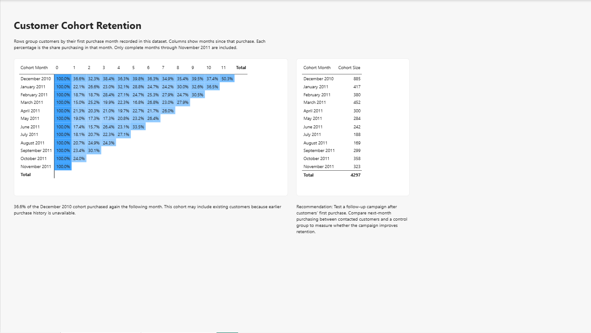
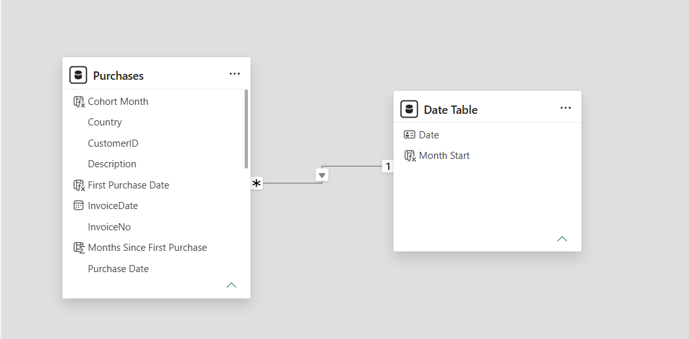

# powerbi-customer-retention
Power BI analysis of retail customer purchasing behaviour and monthly cohort retention using the UCI Online Retail dataset.
# Customer Retention Analysis | Power BI

A two-page Power BI report exploring customer purchasing behaviour and monthly cohort retention.

## Dashboard previews

## Business questions

- What proportion of customers place repeat orders?
- How does monthly customer activity change?
- Which countries have the most customers?
- How often do customers purchase in later months after their first recorded purchase?

## Dataset and preparation

Source: [UCI Online Retail](https://archive.ics.uci.edu/dataset/352/online+retail).

The dataset covers 1 December 2010–9 December 2011. Analysis includes purchases with a known Customer ID, positive quantity and positive unit price. Cancellation invoices are excluded.

Sales are calculated as Quantity × UnitPrice in GBP (£). Returns are excluded, so reported sales are before returns.

## Report pages

**Customer Overview:** Customer and order counts, sales, average order value, repeat purchase rate, monthly active customers, top countries, and country/date filters.

**Cohort Retention:** Customers grouped by their first recorded purchase month, with a heatmap showing the percentage purchasing in each subsequent month and a table of cohort sizes.

## Key findings

Across the full filtered dataset:

- 4,338 customers placed 18,532 orders.
- Sales were approximately £8.91 million.
- Average order value was £480.87.
- 65.6% of customers placed at least two orders.
- Of the 885 customers in the December 2010 cohort, 36.6% purchased the following month.

## Metric definitions

**Repeat purchase rate:** Customers with at least two distinct orders divided by total customers within the current filters.

**Monthly active customers:** Distinct customers who purchased during the month.

**Cohort retention:** Customers purchasing in a given month since their first recorded purchase, divided by the cohort’s starting customer count. Customers do not need to purchase in every intervening month.

## Limitations

- Purchase history before December 2010 is unavailable; first recorded purchases may belong to existing customers.
- December 2011 is incomplete and is excluded from the cohort analysis.
- Later cohorts have fewer observable follow-up months.
- Findings describe historical behaviour and do not establish causes.

## Recommendation

Test a follow-up campaign after customers’ first purchase. Compare next-month purchasing against a control group to assess its effect on retention.

## Skills demonstrated

Power Query cleaning, DAX measures and calculated columns, date-table modelling, filter context, cohort analysis, conditional formatting, and interactive report design.

## Files

- Customer Retention Analysis.pbix — interactive Power BI report
- Customer Retention Analysis.pdf — report preview
- customer-overview.png — overview screenshot
- cohort-retention.png — retention screenshot
- data-model.png — model screenshot

Open the PBIX in Power BI Desktop to explore the report. Refreshing requires downloading the source Excel file and updating its path in Power Query.

